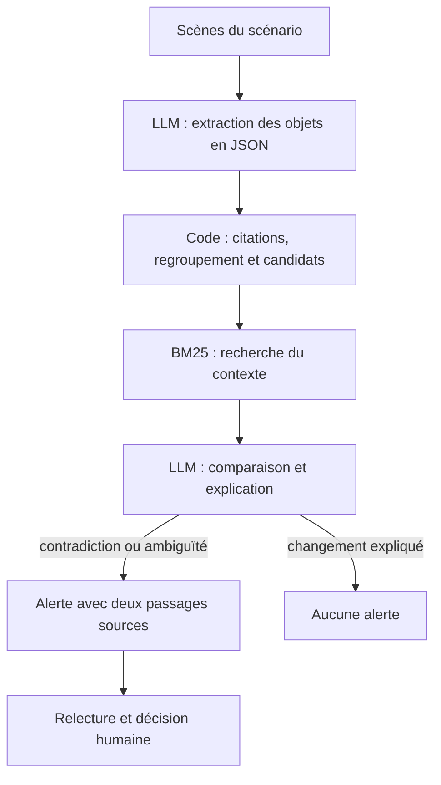

# Faux Raccord

Faux Raccord aide une personne qui relit un scénario à repérer les changements
inexpliqués d’un accessoire entre deux scènes.

Par exemple, une montre est cassée dans une scène puis fonctionne dans la
suivante, sans réparation mentionnée. L’application rapproche ces passages et
propose un point à vérifier. Le lecteur retrouve les deux scènes, décide si
l’alerte est pertinente et peut laisser une note.

Le projet utilise un **LLM avec RAG** : le modèle extrait les accessoires et
leurs états, puis compare les passages retrouvés dans le scénario. L’analyse
porte sur le texte ; les images d’un film et les PDF scannés ne sont pas pris
en charge. Les alertes servent à guider la relecture et peuvent être fausses
ou incomplètes.

## Lancer

Prérequis : **Node.js 24 ou ultérieur**, npm. Depuis ce dossier, lancer
**`start.bat` sous Windows** ou **`./start.sh` sous macOS/Linux**. Les scripts
préparent les dépendances et démarrent le serveur local.

Pour le faire manuellement :

```sh
npm ci
npm run dev
```

Ouvrir **http://127.0.0.1:4173**. Les exemples et les analyses enregistrées sont
consultables sans clé. Pour une nouvelle inférence, configurer Groq dans `.env`
à partir de [.env.example](.env.example), ou utiliser un modèle installé dans
Ollama sur la machine du serveur. Ne jamais ajouter `.env` à Git.

Le catalogue, l’identifiant du modèle et ses paramètres se règlent dans
l’application. Une connexion JSON réussie ne prouve pas la qualité d’extraction :
les petits modèles locaux testés ont produit des citations rejetées. Les scores
ne s’appliquent qu’à la configuration consignée dans chaque rapport.

## Utiliser et comprendre

Le parcours suit trois étapes : **Scénario → Analyse → Relecture**. Un tutoriel
relançable utilise une copie séparée de la démonstration. Les projets restent
sur cet appareil ; exporter le projet JSON pour sauvegarder ou partager notes
et décisions. Il n’y a pas de synchronisation entre les membres.

Dans l’onglet **Scénario**, le champ **Modifier cette scène** demande au modèle
de réécrire la scène affichée selon une consigne (route `/api/edit`). La
proposition s’affiche à côté du texte actuel et n’est appliquée qu’après votre
validation ; une proposition sans l’en-tête de scène est rejetée. Une scène
modifiée est signalée et les alertes existantes sont conservées : relancez
l’analyse pour les mettre à jour. Le champ est masqué pendant le tutoriel.

La **[documentation utilisateur](http://127.0.0.1:4173/#/docs/utiliser)** rassemble
l’utilisation, les données et le fonctionnement, les résultats et tests,
ainsi que les limites et la confidentialité. Sa source unique est
[data/project-guide.js](data/project-guide.js), avec sa traduction dans
[data/project-guide.en.js](data/project-guide.en.js). Le sélecteur Français / English
change l’interface et la documentation utilisateur ; le choix est conservé sur
cet appareil. Les scénarios, citations et résultats déjà enregistrés gardent
leur langue d’origine. Les documents PDF restent en français.

## Fonctionnement technique

L’interface React envoie les scènes sélectionnées au serveur Node.js. Les routes
de `worker/api.js` appellent le pipeline ; le serveur contacte Groq ou Ollama.
La clé Groq sert à l’authentification côté serveur et n’entre pas dans les messages
du modèle. Le découpage, les contrôles et la recherche s’exécutent dans le code.



1. **Découper le texte.** Le parseur reconnaît les en-têtes de scène, comme
   `INT.` et `EXT.`, puis conserve texte, identifiants et pages. Un PDF doit
   contenir du texte sélectionnable. Sans en-têtes reconnus, un découpage de
   secours est signalé ; cette étape n’utilise pas de LLM.
2. **Extraire les mentions.** Le modèle lit des lots de **trois scènes complètes**.
   Le prompt lui demande un JSON : nom et alias de chaque accessoire, puis ses
   mentions avec scène, citation, état, propriétaire, action et repère temporel.
   Les noms et alias des 40 dernières entrées extraites l’aident à réutiliser
   des noms cohérents ; ce n’est pas une mémoire complète du scénario.

   Exemple simplifié d’une mention extraite :

   ```json
   {
     "name": "montre de Runa",
     "aliases": ["brass pocket watch"],
     "mentions": [
       {
         "sceneId": "S001",
         "quote": "Runa drops her brass pocket watch. Its glass breaks and its mechanism stops.",
         "state": "broken",
         "owner": "Runa",
         "action": "break",
         "temporal": "continuous"
       }
     ]
   }
   ```

3. **Contrôler et regrouper.** Le code lit le JSON et vérifie que chaque citation
   existe dans la scène annoncée du lot. La comparaison normalise casse, accents,
   espaces et guillemets, sans accepter une paraphrase. Les états ou actions non
   reconnus deviennent `unknown`. Les mentions sont regroupées par nom normalisé,
   avec des précautions sur le propriétaire, puis classées dans l’ordre des scènes.
   L’identité des objets reste une heuristique : deux objets peuvent être confondus.
4. **Créer des candidats.** Les règles comparent les mentions successives d’un
   même objet : par exemple `broken → intact`, `empty → full` ou un changement
   de propriétaire sans transfert reconnu. Une réparation ou un remplissage
   extrait peut expliquer le changement et supprimer le candidat. Toutes les
   transitions possibles ne sont pas couvertes ; une absence de mention ne
   constitue pas une disparition.
5. **Retrouver le contexte.** Pour chaque candidat, BM25 recherche le nom de
   l’objet et ses alias dans les scènes situées entre les deux mentions, bornes
   incluses. Il classe les passages par correspondance lexicale, fréquence des
   mots et longueur, puis en conserve jusqu’à **cinq**. Ces passages font au plus
   **1 000 caractères**, avec **150 caractères de recouvrement**, sans mélanger
   deux scènes. Ces passages de recherche sont distincts des lots d’extraction.
   La recherche n’utilise ni embeddings ni base vectorielle.
6. **Interpréter et présenter.** Le modèle reçoit le candidat, ses deux mentions
   vérifiées et le contexte retrouvé. Il génère un verdict (`contradiction`,
   `ambiguous` ou `explained`), un titre, une explication et une question. Un
   changement expliqué ne produit pas d’alerte. Les autres points sont présentés
   à la relecture avec les deux preuves déjà validées ; le modèle ne peut pas les
   remplacer. L’utilisateur confirme ou écarte le point et peut ajouter une note.

**Limite du contrôle :** retrouver une citation ne prouve pas que son état ou son
action ont été bien compris. Dans E03, la gourde est interprétée comme remplie
malgré la négation « It has not been refilled ». La règle de remplissage élimine
alors le candidat avant la recherche : le RAG ne peut plus rattraper cette erreur.

La fonction de questions suit un parcours plus court : **question → BM25 →
réponse citée ou `NOT FOUND`**. Le code contrôle les identifiants des citations ;
leur présence ne garantit pas non plus la justesse de la réponse.

| Fichier                               | Responsabilité                                                                            |
| ------------------------------------- | ----------------------------------------------------------------------------------------- |
| [parser.js](src/core/parser.js)       | Découper les scènes et retrouver les citations.                                           |
| [prompts.js](src/core/prompts.js)     | Définir les instructions d’extraction, de comparaison, de réponse et d’édition.           |
| [pipeline.js](src/core/pipeline.js)   | Valider les mentions, créer les alertes, répondre aux questions et proposer des éditions. |
| [retrieval.js](src/core/retrieval.js) | Découper les passages et les classer avec BM25.                                           |
| [model.js](src/core/model.js)         | Appeler Groq ou Ollama et lire le JSON retourné.                                          |

`npm run explain` déroule ce parcours avec des sorties de modèle **simulées et
annoncées**. Cette commande explique le code sans appeler ni mesurer un LLM.

## Choix des modèles

Les nouvelles réponses suivent la langue choisie dans l’interface. Le profil
anglais `english-output-v1` est versionné dans `worker/response-language.js` ;
il ne traduit jamais les preuves et n’hérite pas des scores du profil français.
Changer la langue n’altère pas les analyses déjà enregistrées.
Une question et une analyse en anglais ont été exécutées sur deux scènes synthétiques :
[contrôle opérationnel réel](eval/english-smoke.json). Ce contrôle ne mesure pas
la précision et le rappel du profil anglais.

Le profil mesuré utilise `openai/gpt-oss-120b` sur Groq : sorties JSON,
inférence distante sans charger les poids sur le poste, licence Apache-2.0.
Le passage du 20B au 120B répondait au quota disponible. Les résultats conservés
comparent le pipeline au prompt simple avec le même 120B ; ils ne prouvent pas
qu’il soit meilleur que le 20B. [Capacités Groq](https://console.groq.com/docs/model/openai/gpt-oss-120b),
[configuration et preuves mesurées](eval/controlled-report.json).

Ollama est une option de confidentialité et d’indépendance au réseau, dont le
profil local reste à valider. Les modèles installés sont détectés, sans être
réputés adaptés. La [documentation du moteur](http://127.0.0.1:4173/#/docs/fonctionnement)
justifie trois candidats locaux à partir de sources primaires, distingue leurs
poids de la mémoire totale et propose un protocole commun. Aucun score n’est
attribué à un modèle non testé.

## Données et évaluation

Le scénario réel **Valkaama**, de Tim Baumann d’après Hendrik Behnisch, est publié
sous **CC BY-SA 3.0**. L’expérience principale utilise une adaptation identifiée
contenant **15 incohérences insérées volontairement** pour mesurer la détection.
Le scénario publié reste intact. Les changements, deux passages
de référence et l’attribution sont dans [data/controlled-script/](data/controlled-script/).
La mesure porte sur les scènes 1–12 du scénario complet et ses 19 accessoires
annotés : 15 incohérences et quatre transitions expliquées. Les autres alertes
sont conservées à relire, hors de cette précision contrôlée.

La précision mesure les alertes rapprochées des injections attendues ; le rappel
mesure les injections retrouvées. Les associations sont inspectables, sans
compter plusieurs fois la même erreur. Une baseline au même modèle reçoit un
prompt direct. Le rapport conserve les échecs et ne présume pas la supériorité
du pipeline. Les anciennes vignettes synthétiques et la QA réelle sont des
expériences complémentaires, distinctes de ce benchmark.

```sh
npm test
node eval/controlled-run.mjs
node --env-file=.env eval/controlled-run.mjs --live
node --env-file=.env eval/red-team.mjs
npm run format:check
npm run build
```

La commande sans `--live` valide les références et les résultats enregistrés ;
elle n’invente aucun score. `--live` appelle le modèle et consomme un quota.
Sans `--model`, une nouvelle mesure reprend le modèle du rapport existant.
Les tests du code utilisent des fournisseurs simulés lorsque nécessaire ; ils
ne mesurent pas la qualité réelle du modèle. `eval/red-team.mjs` envoie 20 demandes
malveillantes (17 questions, 3 éditions de scène) au vrai modèle et consomme un
quota ; la grille est mécanique et n’évalue pas la qualité des réponses
([journal](docs/red_team_log.md)). Détails et commandes historiques :
[eval/README.md](eval/README.md).

L’application propose aussi un import utilisateur et une bibliothèque MovieSum.
L’index local contient des métadonnées ; aperçu et import nécessitent le réseau.
La licence du dataset ne garantit pas les droits des œuvres sous-jacentes.
Sources, transformations et licences : [data/README.md](data/README.md).

## Livrables et limites

- [Rapport d’évaluation](docs/evaluation_report.md) · [PDF, deux pages](docs/print/evaluation.pdf).
- [Fiche système](docs/system_card.md) · [PDF, une page](docs/print/system-card.pdf).
- [Politique d’utilisation](docs/use_policy.md) · [Journal de red team, 20 essais](docs/red_team_log.md).

Groq reçoit les scènes ou extraits nécessaires aux appels ; Ollama permet un
traitement local. Les clés restent côté serveur, les preuves introuvables sont
rejetées et la décision finale reste humaine. Une citation présente ne garantit
pas une interprétation juste. Les limites concernent notamment les transferts
implicites, les objets homonymes, les flashbacks et la recherche multilingue.
L’utilité en tournage et les annotations attendent une validation humaine ; les
retours internes de prise en main ne remplacent pas cette validation métier.

## Équipe et outils IA

Yann QUEGUINER · Jean-Remy BITOUMBOU-BIBOKA · Simon LUSSATO.

Pour signaler un problème : [issues du dépôt](https://github.com/Ybelis/faux-raccord/issues).

Le développement a été réalisé avec l’assistance de Codex pour le code,
les tests, la recherche de sources et la documentation. Groq fournit les
inférences consignées dans les rapports. Canva a servi au support de cadrage,
conservé à part du code.

Le code est sous [licence MIT](LICENSE). Les scénarios et leurs adaptations
conservent leurs propres licences et attributions.
