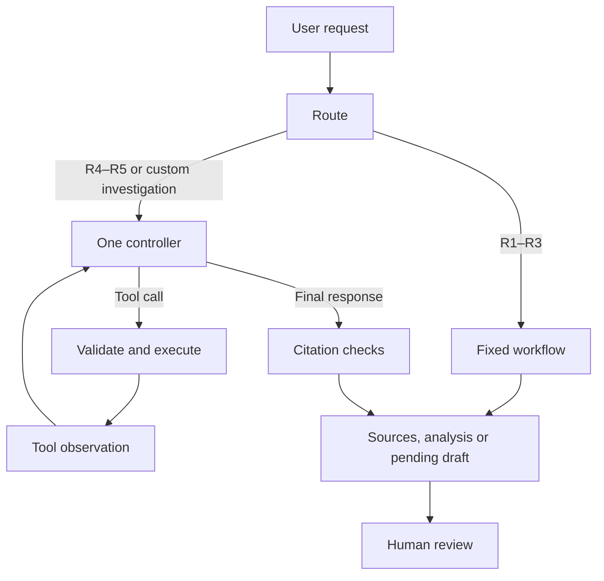

# Faux Raccord — Agent sheet

## Purpose

Faux Raccord helps screenplay writers and editors review prop continuity. The
assistant investigates a specific continuity doubt, explains its
recommendation with source passages and prepares corrections for review.

The command-line prototype implements the five requests below using LangGraph.
The web application retains its existing analysis and editing workflows. The
agent's recorded executions demonstrate functionality, not general detection
accuracy or a measured improvement in user productivity.

## Five user requests

The examples use the [controlled Valkaama adaptation](../data/controlled-script/),
where the watch and notebook inconsistencies were deliberately inserted; they
are not claims about the original screenplay.

| ID  | User request                                                                                                                                                         | Decision | Justification                                                                                                                                                |
| --- | -------------------------------------------------------------------------------------------------------------------------------------------------------------------- | -------- | ------------------------------------------------------------------------------------------------------------------------------------------------------------ |
| R1  | “Show me both source passages behind the watch alert between scenes S001 and S002.”                                                                                  | Workflow | The alert already identifies the passages, so a fixed sequence can retrieve and display them.                                                                |
| R2  | “Check prop continuity in scenes S001–S012 and show the source passages for each alert.”                                                                             | Workflow | The scene range is explicit and the existing extraction, retrieval and comparison pipeline determines the steps.                                             |
| R3  | “In scene S002, keep Runa’s watch broken and change as little else as possible; show me the proposed text before applying it.”                                       | Workflow | The target scene and requested change are specified, so a fixed draft-and-review process is sufficient.                                                      |
| R4  | “I am not convinced by this watch alert: investigate whether the script explains the change before recommending that I keep or dismiss it.”                          | Agent    | The model chooses follow-up searches and passages to inspect from the evidence it finds, then returns a supported recommendation or an explicit uncertainty. |
| R5  | “Lasse’s red notebook is destroyed and later appears intact: find the least intrusive way to resolve this inconsistency and prepare a correction for me to approve.” | Agent    | The model inspects the context, chooses which scene to change and decides what further checks the proposed correction needs before presenting a draft.       |

These decisions describe our chosen implementation: a workflow fixes the steps
in code, while an agent chooses its next tool calls from observed results. The
number of model calls alone does not determine the classification.

## Boundaries and success

Investigations stay within the selected screenplay and have limits enforced by
the code. A useful result gives a recommendation with verifiable passages, or
states what remains uncertain; an unsuccessful search does not establish that
no explanation exists. A correction succeeds only if the approved change
addresses the identified issue without altering unrelated content. Applying a
draft requires human approval and preserves the original version.

## Tool contracts — Session 2

The three [tool schemas](../agent/tool_schemas.json) define names, descriptions,
parameters and access levels, with one example call each. `parameters` contains
the JSON Schema; `access` and `example_arguments` are repository metadata, not
arguments sent by the model. The host can adapt these definitions to native
function calling or MCP.

| Tool                    | Access                          | Parameters                                                                                       | Existing code to reuse                                                                  |
| ----------------------- | ------------------------------- | ------------------------------------------------------------------------------------------------ | --------------------------------------------------------------------------------------- |
| `search_passages`       | Read                            | `query` (1–500 characters), optional `scene_ids` (up to 200), optional `top_k` (1–5, default 5). | `retrieve()` in `src/core/retrieval.js`.                                                |
| `check_continuity`      | Read; consumes model quota      | `scene_ids` (1–12 unique identifiers).                                                           | `analyze()` in `src/core/pipeline.js`.                                                  |
| `create_revision_draft` | Write; creates a separate draft | `scene_id`, `instruction` (3–800 characters).                                                    | `editScene()` for generation and `DraftStore` in `agent/state.py` for separate storage. |

`search_passages` runs through the Session 3 MCP server below. The other two
tools run through the local action bridge introduced in Session 5. The host binds every call to
one selected, validated screenplay snapshot;
custom projects currently live in browser storage and must be supplied
explicitly. Project paths, URLs, API keys, model settings and consent are not
model-controlled parameters.

Schema validation rejects unknown arguments, wrong types, invalid identifier
formats and out-of-range values. Before execution, the host also checks
that identifiers exist, trims text and rechecks lengths, rejects blank or
NUL-containing input, restores screenplay order, and enforces the selected text
and execution budgets.
Analysis is limited to 120,000 characters in addition to the twelve-scene cap;
search passages retain the existing 1,000-character maximum. An empty search
is a valid result; invalid input, a missing scene, refused consent, stale
revision or model failure must produce an actionable error rather than a
fabricated result. Read access describes project effects, not inference cost.

Model calls require consent supplied by the host. The draft adapter saves a
separate proposal after the generation function validates its single-scene
structure; the original and review decisions stay intact. Refused or invalid
proposals create no draft. Repeating the same operation and validated payload
returns the existing draft; conflicting reuse is rejected. The agent has no apply tool: applying a
proposal is a separate human action, outside this prototype's agent loop.

## MCP server — Session 3

[server.py](../agent/server.py) exposes `search_passages` over stdio with the
exact S2 description and parameter schema. A fixed
[Node bridge](../agent/search_bridge.mjs) calls the existing parser and BM25;
the search logic is not duplicated in Python. No web server, model or API key is
needed. Launch and replay instructions are in the [README](../README.md#serveur-mcp).

```text
Session 3 notebook → MCP client → server.py → search_bridge.mjs → retrieve()
                    ← referenced screenplay passages ←
```

The launcher chooses the controlled Valkaama adaptation by default, or the
original with `--sample valkaama`. Only these two bundled corpora are exposed;
browser projects and arbitrary files are not connected yet. A SHA-256 hash pins
the source revision at startup, and subsequent calls reject a changed source.
The bridge runs without a shell or inherited API keys, has a ten-second timeout,
and limits JSON input to 16 KiB and output to 64 KiB. These are application
controls; stdio still runs as a local process with the user's OS permissions.

The executed [Session 3 project notebook](../agent/session3.ipynb) discovers the
tool, checks its description and schema against S2, and retrieves the two watch
passages in S001 and S002. It also records a valid empty search and rejected
requests for an unknown scene and an excessive result limit. These are real
MCP calls with zero model calls; they do not measure LLM quality. Python stdio
tests and Node bridge tests cover these boundaries independently of the web UI.

## Control and memory — Session 4

1. Control: one bounded ReAct controller chooses its next tool from observations; R1–R3 retain fixed workflows.
2. Working memory: the request, script revision, passages and tool results exist only for the current run, up to five minutes.
3. Limits: code allows six controller calls, eight tool calls and sixteen model calls total, including calls inside analysis tools.
4. Persistence: pending drafts are stored locally and expire after seven days; a new run never loads them or old traces as model memory.
5. Trust: retrieved text remains untrusted data, missing evidence means uncertainty, and applying any correction remains a human action.

The [versioned configuration](../agent/config.json) records these limits. Exact
read calls may reuse their results within the same run and source revision.

## Framework and execution — Session 5

[runner.py](../agent/runner.py) builds an explicit LangGraph graph:



LangGraph **1.2.20** provides the state and conditional edges; our code controls
the tools and limits. It fits the combination of fixed workflows and adaptive
investigations without introducing additional autonomous agents.
[Graph API reference](https://docs.langchain.com/oss/python/langgraph/graph-api).

The [recorded runs](../agent/evidence/session5.json) retain eight real attempts,
including three initial failures. The latest execution of each request is:

| Request | Observed result                                                                          | Model request attempts | Duration |
| ------- | ---------------------------------------------------------------------------------------- | ---------------------: | -------: |
| R1      | Two source passages returned through MCP.                                                |                      0 |    3.1 s |
| R2      | Twelve scenes analysed; five candidate alerts returned.                                  |                     10 |  192.7 s |
| R3      | One separate watch-correction draft saved for review.                                    |                      1 |    2.5 s |
| R4      | Two source passages cited; the controller reports uncertainty and an unexplained change. |                      2 |    4.3 s |
| R5      | One notebook-correction draft saved; its uncited model summary is withheld.              |                      5 |   67.7 s |

These are functional cases from the visible development screenplay, not an
independent quality benchmark. Request attempts include temporary provider
failures; unavailable token counts are marked as unmeasured. The initial runs
exposed a rate limit and a malformed attempt to call a nonexistent `JSON`
function. The controller now concludes in ordinary text, separately from tool
calls, and temporary rate limits have a bounded wait and retry. R5 still exposes
a useful limitation: the proposed edit exists, but the model's summary omitted
citations, so the guard returned uncertainty rather than publishing that summary.
R3 also needs human review: its proposal stops the watch mechanism but leaves
the glass intact, despite the earlier breakage. A saved, structurally valid
draft therefore does not establish that the continuity problem is fully fixed.

## Agent design — Session 6

**One agent.** A single controller investigates one screenplay and owns the
request state. Its three tools share the same source revision. Separate agents
would add context transfers and coordination without an identified need in
these five cases. Extraction and judgment inside `check_continuity` remain
fixed model calls, not independent agents.

| Field             | Decision                                                                                                                                                                                  |
| ----------------- | ----------------------------------------------------------------------------------------------------------------------------------------------------------------------------------------- |
| User              | A screenplay writer or editor reviewing prop continuity.                                                                                                                                  |
| Goal              | Investigate a specific continuity doubt and return source passages, an explicit uncertainty, or a pending correction draft.                                                               |
| Model             | Groq `openai/gpt-oss-120b`, temperature 0; native tool calling and continuity generation are tested separately.                                                                           |
| Model rationale   | Reuse the model already exercised by the detector and support native tool calls; the current evidence does not establish that it is the cheapest or best model.                           |
| Framework         | LangGraph 1.2.20, with explicit routes, state and stopping conditions.                                                                                                                    |
| Data              | The licensed Valkaama screenplay and its clearly labelled controlled adaptation; screenplay by Tim Baumann based on Hendrik Behnisch, CC BY-SA 3.0.                                       |
| Read tools        | `search_passages` and `check_continuity`.                                                                                                                                                 |
| Write tool        | `create_revision_draft`, which stores an unapplied proposal.                                                                                                                              |
| Autonomy          | Fixed routes for R1–R3; one bounded ReAct controller for R4–R5 and custom investigations.                                                                                                 |
| Working memory    | Current request, source revision and tool observations; discarded after the run, never shared across projects.                                                                            |
| Persistent state  | Pending drafts expire after seven days and are deleted on access after expiry; recorded test traces are audit evidence and are never loaded as conversational memory.                     |
| Stop rules        | Six controller requests, eight tool calls, sixteen total model requests and five minutes; errors, missing evidence and unavailable quota are explicit outcomes.                           |
| Human control     | Consent before model processing; all drafts remain `pending_review`, with no agent tool to apply or overwrite the screenplay.                                                             |
| Success checks    | Source references must exist in the run; analyses identify their exact scene scope; a draft must actually be saved separately against the unchanged source revision.                      |
| Current interface | A local CLI with live execution and clearly labelled recorded replay; the React UI does not yet invoke this controller.                                                                   |
| Limits            | Fallible extraction and interpretation, incomplete lexical search, latency and quota limits; no visual continuity analysis, browser-project integration or automatic correction approval. |

### Two-minute kickoff pitch

Imagine a watch breaks in one scene and works again in the next. A reader has to
find both passages, check whether anything explains the change, and decide
whether it needs a correction. Faux Raccord supports that review.

Our first version used a fixed pipeline to extract props and compare their
states. We now also support a targeted request: investigate this alert and,
if needed, prepare a small correction.

We use one controller with three tools: search the screenplay, check continuity
in selected scenes, and create a revision draft. The controller chooses its
next action from the results. Simple requests still follow fixed workflows.
LangGraph makes those paths and stopping conditions explicit.

We chose one agent because these tasks share one screenplay and one goal.
Splitting the work would add coordination and repeated context without a
demonstrated benefit.

Safety boundaries live in the code. The agent reads a pinned source revision,
has a shared call and time budget, and cannot overwrite the original. Drafts
remain separate and require human review. Working memory ends with each run.

We executed five real requests and kept the traces, including failures. One
model summary lacked citations, so it was withheld while the saved draft
remained available. Another draft left an inconsistent detail, which still
needs human correction. That illustrates our aim: useful evidence and reviewable
proposals, with visible limits, rather than automatic claims that a screenplay
is now correct.
