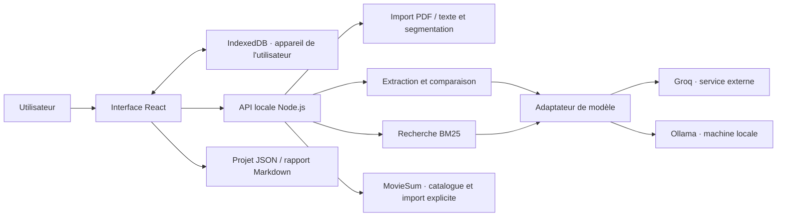
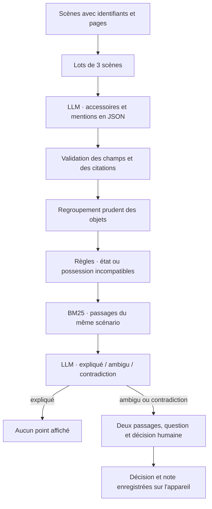
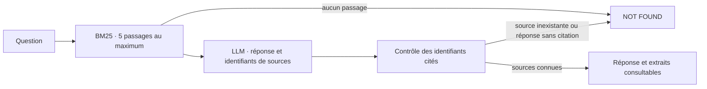

# Architecture

Faux Raccord relie les mentions d'un même accessoire dans un scénario et propose des points de continuité à relire. La génération ne décide pas à la place du scripte : chaque point conserve deux passages sources et une décision humaine distincte.

## Composants et circulation des données

Le serveur lit les secrets dans son environnement. Le navigateur reçoit la disponibilité du fournisseur, les résultats et les mesures d'exécution. Il ne reçoit pas la clé. Avec Groq, les scènes sélectionnées et les extraits utiles quittent la machine. Avec Ollama, le moteur tourne sur la machine qui exécute le serveur local. Les documents restent aussi dans IndexedDB ; ce stockage n'est ni une sauvegarde distante ni une synchronisation d'équipe.

Le même cœur ESM peut être compilé dans un Worker. Le développement et les vérifications actuelles se font en local ; la publication n'est pas nécessaire pour exécuter le produit.

## Analyse de continuité

Une mention absente ne crée jamais à elle seule un candidat. Les changements d'état examinés sont ceux du dictionnaire explicite de `findCandidates()`, par exemple brisé → intact ou vide → plein. Ce dictionnaire ne couvre pas tous les changements possibles. Une réparation ou un remplissage explicite peut annuler un candidat. Les ellipses, flashbacks et transferts restent une source d'erreurs.

Les noms connus sont réinjectés dans les lots suivants pour réduire les variations de nommage. Le regroupement ne garantit pas l'identité physique : deux objets peuvent être confondus, ou un seul objet peut rester séparé sous deux noms.

## Questions sur le scénario

La recherche découpe chaque scène en passages de 1 000 caractères au maximum, avec 150 caractères de recouvrement. Les limites de scène sont conservées. Ces valeurs sont des choix initiaux : aucune étude comparative de tailles de passages n'a encore démontré qu'elles sont optimales.

Le RAG est lexical, sans embeddings ni entraînement des poids. Il privilégie les noms et accessoires explicitement mentionnés. Il peut manquer une paraphrase ou une question française sur un texte anglais. La présence d'un identifiant valide ne prouve pas que la réponse est sémantiquement justifiée ; l'utilisateur garde accès à l'extrait pour le vérifier.

## Frontières de confiance

| Frontière | Contrôle | Limite restante |
|---|---|---|
| Fichier importé | Formats, taille, pages, volume de texte ; PDF sans évaluation de scripts | Pas d'OCR ; segmentation imparfaite |
| Texte fourni au LLM | Instructions des documents traitées comme données ; absence de clé dans les prompts | Résistance aux injections non garantie |
| Extraction LLM | Schéma contrôlé et recherche des citations dans la scène | La correspondance normalise espaces, casse et accents ; elle ne valide pas l'interprétation |
| Réponse à une question | Rejet des identifiants absents des passages fournis et des réponses sans citation | Une source existante peut être mal interprétée |
| Point de continuité | Deux passages, statut et note de revue séparés | Couverture limitée et erreurs possibles du modèle |
| Partage | Export explicite par l'utilisateur ; aucune action automatique vers un tiers | L'export est un fichier à gérer par l'équipe |

## Repères dans le code

| Composant | Fichier |
|---|---|
| Interface et parcours | `src/main.jsx`, `src/components/`, `src/styles.css` |
| Stockage et exports | `src/storage.js` |
| Scènes, pages et citations | `src/core/parser.js` |
| Découpage des passages et BM25 | `src/core/retrieval.js` |
| Contrats de génération | `src/core/prompts.js` |
| Extraction, candidats, comparaison, questions | `src/core/pipeline.js` |
| Fournisseurs et requêtes du modèle | `src/core/model.js` |
| Routes et limites HTTP | `worker/api.js` |
| Catalogue et provenance des imports externes | `worker/sources.js` |
| Exécution locale et compilation | `scripts/dev.mjs`, `scripts/build.mjs` |

La séparation de ces fonctions prépare une éventuelle extension agentique. Aucun agent autonome, outil d'envoi ou planificateur n'est annoncé comme déjà réalisé.
